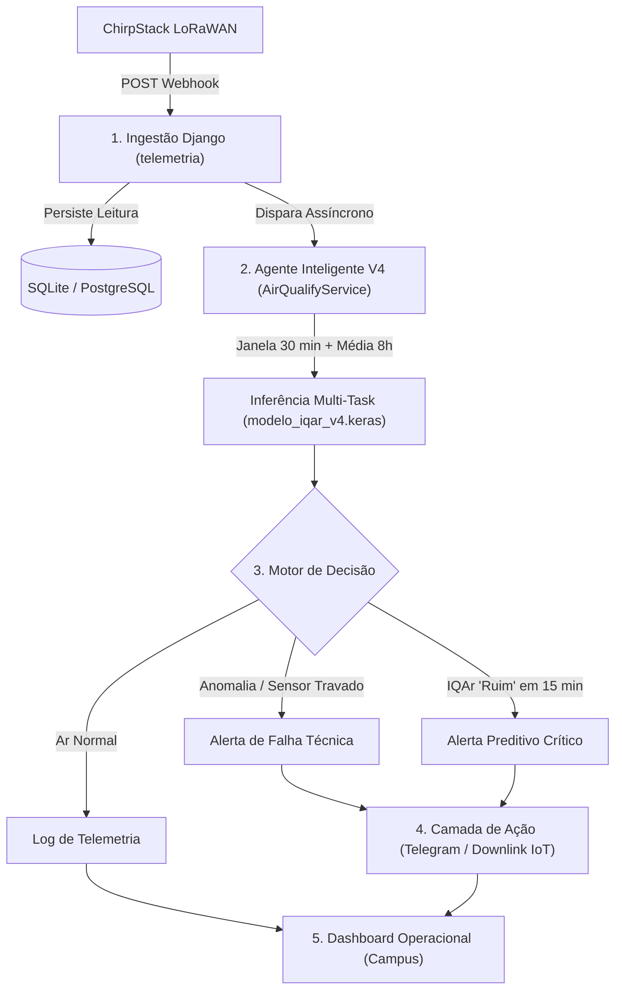

# Registro da Sessão: Análise Crítica dos Experimentos de Normalização (V3 vs. V4) e Plano de Implementação do Agente

**Projeto:** Agente Inteligente para Monitoramento da Qualidade do Ar em Smart Campus (UFPA Tucuruí)  
**Autor:** Noedson Romário Vieira da Silva  
**Data:** 20/10/2026  
**Status:** Análise metodológica concluída e roteiro de implementação estruturado.

---

## 1. Contexto e Motivação da Sessão

Nesta sessão, foi realizada uma auditoria crítica e sistemática com postura de **"Advogado do Diabo"** sobre os experimentos de ablação armazenados na pasta `Código/experimentos/`:
1. Avaliação do impacto da normalização de dados (`clipping P99.5` + `log1p` + `MinMaxScaler [0, 1]`) versus dados em escala bruta real (ppm).
2. Confronto direto entre as arquiteturas **V3** e **V4** treinadas do zero.
3. Identificação de inconsistências entre o relatório técnico gerado e os dados brutos de teste (`experimento_normalizacao_resultados.json`).
4. Formulação do plano estratégico de 5 fases para colocar o Agente Inteligente em operação com o Django e ChirpStack.

---

## 2. Auditoria "Advogado do Diabo": O Relatório vs. Os Dados Brutos

### A. Matriz Consolidada de Resultados

| Métrica Avaliada | V3 (Normalizado) | V3 (Sem Normalização) | V4 (Normalizado) | V4 (Sem Normalização) | Persistência Ingênua |
| :--- | :---: | :---: | :---: | :---: | :---: |
| **CO MAE (ppm)** | 765.98 | 792.30 | **765.69** | 784.81 | 1524.38 |
| **CO RMSE (ppm)** | 57928.81 | 57930.40 | **57928.85** | 57930.74 | 81923.58 |
| **Skill Score MAE CO (%)** | +49.75% | +48.02% | **+49.77%** | +48.52% | 0,00% (Ref.) |
| **Skill Score MAE Médio (Todos Gases)** | +42.47% | +30.59% | **+42.97%** | +36.21% | 0,00% (Ref.) |
| **Acurácia nas Transições (IQAr)** | 43.16% | **55.79%** | 49.47% | 45.26% | 0,00% |
| **Acurácia Balanceada IQAr** | 97.40% | 96.67% | 97.96% | 93.21% | **98.67%** |
| **F1-Score Macro IQAr** | 97.98% | 97.30% | 98.38% | 94.20% | **98.38%** |
| **AUC Detecção Anomalias (Autoencoder)** | **94.31%** | 87.41% | 93.69% | 87.06% | N/A |
| **Épocas até Convergência** | 30 | 30 | **24** | 30 | N/A |

---

### B. Vulnerabilidades Críticas e Fatos Incômodos Identificados

1. **A Omissão da Acurácia de Transição:**
   * O relatório técnico declarou que o V4 Normalizado obteve *"alta acurácia nas transições"*, mas os dados revelam que o modelo com maior acurácia nas transições foi o **V3 Sem Normalização (55.79%)**, superando o V4 Normalizado (49.47%) e o V3 Normalizado (43.16%).
2. **O Paradoxo da Persistência no IQAr:**
   * A Persistência Ingênua (repetir a classe atual de ar) obteve **98.67% de acurácia balanceada**, superando **todos os modelos de Deep Learning** (V4 Normalizado obteve 97.96%). Isso ocorre porque o ar é estacionário na vasta maioria do tempo. A rede neural só se justifica pela capacidade de **antecipar transições de classe**, onde a persistência pontua exatamente 0%.
3. **Falha Metodológica no Teste de Anomalia (Autoencoder):**
   * No script `experimento_normalizacao.py`, a perturbação sintética injetada foi:
     ```python
     mag_injecao = 0.2 if normalizado else 5.0
     ```
   * $+0.2$ em dados normalizados $[0, 1]$ representa **20% de toda a faixa dinâmica**.
   * $+5.0$ ppm em dados brutos de CO (que operam na casa de 1000 ppm) representa **menos de 0.5%** da faixa dinâmica. A queda de AUC no modelo sem normalização (de 93.7% para 87.1%) foi artificialmente amplificada por uma anomalia proporcionalmente minúscula.
4. **Fragilidade Amostral nas Transições ($N = 95$):**
   * O conjunto de teste contém apenas **95 transições de classe**.
   * A diferença entre o V4 Normalizado (49.47% = 47 acertos) e o V4 Sem Normalização (45.26% = 43 acertos) é de **apenas 4 eventos**. Concluir superioridade categórica sem teste estatístico formal (McNemar ou Bootstrap) é arriscado frente a uma banca examinadora.
5. **Indiferença Estatística no RMSE do CO:**
   * O RMSE do CO foi de 57.928 ppm em todos os cenários. A diferença entre normalizar ou não foi inferior a 2 ppm em 58 mil ppm (variação de 0.003%), demonstrando que o erro quadrático é governado por outliers severos no conjunto de teste.

---

## 3. Houve Melhora na Previsão com a Normalização?

**Veredito:** **SIM**, houve melhora sólida e consistente em todos os 7 gases, mas com comportamentos assimétricos:

* **Nos Gases de Baixa Escala (Transformador):**
  * **Metano ($CH_4$ / MH4):** No V3 Sem Normalização, o modelo colapsou com Skill MAE negativo (**-9.06%** — pior que persistência). Com normalização, atingiu **+40.44%**.
  * **Ozônio ($O_3$):** No V4 Sem Normalização, o Skill MAE caiu para **+0.92%** (abandono prático da dinâmica temporal). Com normalização, subiu para **+14.06%**.
  * **Tolueno:** Aumento de +13.2 p.p. no V3 e +10.2 p.p. no V4.
* **No Monóxido de Carbono (Tímido):**
  * O ganho no CO foi modesto: redução de apenas 19 a 26 ppm no MAE (~2.4% a 3.3% de ganho relativo), pois na escala bruta o CO já dominava os gradientes da retropropagação.
* **Mecânica Teórica:** A normalização impediu a "morte por asfixia de gradientes" dos sensores de baixa concentração, viabilizando um modelo genuinamente multivariado.

---

## 4. Comparativo Direto: V3 vs. V4 sob Dados Normalizados

* **Previsão Contínua (Regressão):** **Empate Técnico absoluto.**
  * CO MAE: 765.98 ppm (V3) vs 765.69 ppm (V4) — diferença de 0.29 ppm.
  * CO RMSE: 57928.81 ppm (V3) vs 57928.85 ppm (V4).
  * Skill Médio de todos os gases: 42.47% (V3) vs 42.97% (V4).
* **Inteligência de Decisão e Classificação (Vitória do V4):**
  * Acurácia nas transições críticas: **49.47% (V4)** vs 43.16% (V3) — ganho de **+6.31 p.p.**
  * Recall na classe Crítica "Ruim": **95.31% (V4)** vs 93.44% (V3).
  * Taxa de alarme falso no Autoencoder: **7.76% (V4)** vs 9.85% (V3).
  * Eficiência de convergência: V4 parou na **época 24** via Early Stopping; V3 esgotou as **30 épocas**.
* **Explicação do Design:**
  * O V3 sobrecarregava o regressor de delta com penalidades assimétricas de sinal e peso focal de 3.0x, gerando conflito interno com a cabeça de classificação.
  * O V4 separou os papéis: adotou Huber simétrica suave (peso 1.0x) no delta para aprender a física dos gases e concentrou o peso focal (3.5x) exclusivamente na cabeça de classificação do IQAr.

---

## 5. Plano de Implementação do Agente Inteligente (Roadmap Operacional)



### Fase 1: Atualização e Sincronização do Serviço de Inferência (Core)
1. Atualizar `agente/services.py` para carregar explicitamente `modelo_iqar_v4.keras` (atualmente aponta para o V3 legado `modelo_iqar.keras`).
2. Sincronizar parâmetros de produção com `agente/config_agente.json` (`limiar_anomalia: 0.12456`, `eps_travado: 0.00194`, `clip_max` e `delta_std` oficiais do V4).
3. Validar a função de inversão de escala no serviço para garantir fidelidade com o treino (`expm1` + scaler inverso).

### Fase 2: Desacoplamento e Performance Assíncrona
1. **Problema:** A rota `chirpstack_webhook` atualmente executa queries de 8 horas e inferência TensorFlow de forma síncrona na requisição HTTP, gerando risco de timeout no gateway LoRaWAN.
2. **Solução:** Implementar fila em background (via Celery/Redis ou `concurrent.futures.ThreadPoolExecutor`) para responder `HTTP 200 OK` imediatamente após persistir o dado cru, executando o agente em segundo plano.

### Fase 3: Camada de Ação Autônoma do Agente
1. **Notificações em Tempo Real:** Integrar bot de Telegram / Webhook para envio imediato de mensagens aos operadores do campus em caso de risco de ar "Ruim" ou anomalia técnica.
2. **Atuação IoT (Downlink LoRaWAN):** Implementar chamada de API de retorno ao ChirpStack para envio de payloads de comando (acionamento de exaustores, filtros de ar ou sinalizadores sonoros/luminosos no laboratório).

### Fase 4: Simulação de Replay e Validação Ponta a Ponta
1. Desenvolver script de replay acelerado (`simular_telemetria_tempo_real.py`) consumindo amostras cronológicas de `event_up.csv`.
2. Validar na prática:
   * Funcionamento do cooldown de 15 minutos em alertas.
   * Detecção de sensor travado em tempo de execução.
   * Estabilidade de memória do TensorFlow após milhares de inferências consecutivas.

### Fase 5: Dashboard Operacional para Smart Campus
1. **Interface do Usuário:** Semáforo visual de risco IQAr em tempo real para a comunidade acadêmica.
2. **Interface do Gestor:** Painel analítico com gráfico Real vs. Previsto (15 min à frente) e tabela de eventos/anomalias com status de resolução.
