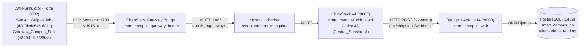

# Registro Completo da Sessão: Otimização de CPU do Container Web e Integração do Simulador LoRaWAN (LWN-Simulator)

**Projeto:** Monitoramento Autônomo da Qualidade do Ar com IA Multi-Task (LoRaWAN / ChirpStack v4 / Django / Keras)  
**Data da Sessão:** 29/10/2026 – 30/10/2026  
**Status:** Implementado, integrado ao Docker Compose e validado de ponta a ponta com gravação real no PostgreSQL.

---

## 1. Diagnóstico e Solução para o Consumo de CPU do `smart_campus_web`

### Pergunta 1 (Usuário):
> *"porque o smart_campus_web está consumindo muito processador?"*

### Diagnóstico Realizado:
Ao inspecionar os processos em execução (`docker top smart_campus_web`), estatísticas (`docker stats`) e logs do container, identificamos que o container mantinha um consumo contínuo de **~13% a 20% de CPU** e **~872 MB de RAM** mesmo quando ocioso, causado por **3 fatores combinados**:

1. **`StatReloader` do Django varrendo milhares de arquivos a cada 1 segundo (Causa Principal em Ociosidade):**
   * O `entrypoint.sh` iniciava o servidor com `python manage.py runserver 0.0.0.0:8000`.
   * Por padrão, o `runserver` ativa o *Auto-Reload* com o `StatReloader`.
   * Como o **TensorFlow**, **Keras**, **Scikit-Learn**, **Pandas** e **SciPy** são importados logo no carregamento das rotas (`urls.py` $\rightarrow$ `telemetria/views.py` $\rightarrow$ `agente/services.py`), milhares de arquivos `.py` ficam registrados em `sys.modules`.
   * Somado ao mapeamento do diretório local `- .:/app` (incluindo a pasta `venv` no Windows) via bridge de arquivos do Docker Desktop (WSL2/9P), o loop de chamadas `os.stat()` a cada 1 segundo gerava uso constante de CPU.
2. **Inicialização repetida do TensorFlow no boot (Pico de CPU na Subida):**
   * Durante a execução do `entrypoint.sh`, o TensorFlow era carregado 5 vezes seguidas (`makemigrations`, `migrate`, `garantir_superuser.py`, processo pai do `runserver` e processo filho do `runserver`).
3. **Exclusão do `event_up.csv` (471,3 MB) no `.dockerignore`:**
   * O arquivo bruto `event_up.csv` estava sendo copiado para o contexto de build da imagem Docker a cada `docker compose up --build`, tornando o build lento. Foi adicionado ao `.dockerignore`.

---

### Pergunta 2 (Usuário):
> *"quais as consequencias do noreload e do lazyimport?"*

### Síntese das Consequências Explicadas:
* **`--noreload` no `runserver`:**
  * **Vantagens:** O consumo de CPU em repouso cai para **0,0%** e o uso de memória RAM cai quase pela metade (sobe apenas 1 processo Python em vez de 2). O *Hot-Reloading* do modelo de IA (`AirQualifyService.recarregar_modelo()`) continua funcionando normalmente.
  * **Desvantagem:** Se alterar arquivos `.py` com o container rodando, o Django não reinicia sozinho (sendo necessário `docker restart smart_campus_web`).
* ***Lazy Import* do TensorFlow:**
  * **Vantagens:** Os comandos administrativos (`makemigrations`, `migrate`, `garantir_superuser.py`) passam a rodar em menos de 1 segundo sem carregar o TensorFlow.
  * **Desvantagem:** A 1ª requisição recebida pelo webhook após o boot leva ~2 a 3 segundos para importar o TensorFlow e carregar o `.keras` (da 2ª leitura em diante, o *Singleton* responde em milissegundos).

---

### Pergunta 3 (Usuário):
> *"talvez podemos colocar um argumento, tipo, --development (deixa do jeito que está) e --production (ativa o --noreload)."*  
> *"mude production para produção e development para desenvolvimento."*  
> *"como concertar isso aqui, (não está parecendo os caracteres especiais)"* *(Imagem mostrando `PRODUçãO` no PowerShell)*

### Implementação dos Modos `--desenvolvimento` e `--produção` + Correção de Codificação UTF-8:
1. **`Código/entrypoint.sh`:**
   * Passou a aceitar `--desenvolvimento` (`-d`) e `--produção` (`--producao` / `-p`), além da variável de ambiente `APP_MODE`:
     * **Modo `desenvolvimento` (padrão):** Executa `python manage.py runserver 0.0.0.0:8000` (com *auto-reload* ativo).
     * **Modo `produção`:** Executa `python manage.py runserver 0.0.0.0:8000 --noreload` (0% de CPU em ociosidade).
2. **`Código/docker-compose.yml`:**
   * Adicionada a variável `APP_MODE: ${APP_MODE:-desenvolvimento}` no serviço `web`.
3. **`Código/iniciar_docker.ps1` e `Código/parar_docker.ps1`:**
   * Suporte aos argumentos de linha de comando:
     ```powershell
     .\iniciar_docker.ps1 --desenvolvimento
     .\iniciar_docker.ps1 --produção
     ```
   * **Correção definitiva de acentuação no Windows PowerShell 5.1:**
     * Arquivos `.ps1` salvos com codificação **UTF-8 com BOM (*Byte Order Mark*)**, exigida pelo Windows PowerShell 5.1 para não interpretar UTF-8 como Windows-1252 (`PRODUçãO`).
     * Adicionado `[Console]::OutputEncoding = [System.Text.Encoding]::UTF8` no script principal e no comando de cada aba do Windows Terminal (`docker logs -f`).

---

## 2. Configuração e Integração do Simulador LoRaWAN (`UniCT-ARSLab/LWN-Simulator`)

### Pergunta 4 (Usuário):
> *"proximo passo, configurar o https://github.com/UniCT-ARSLab/LWN-Simulator para teste da arquitetura antes do teste de fato (ir para a universidade) esse repositória irá testar se a nossa arquitetura está salvando os dados."*

### Arquitetura de Teste Ponta a Ponta Implementada:



### Descobertas Técnicas e Correções Aplicadas no Código do `LWN-Simulator` para o Padrão `AU915_0`:
Ao analisar o código-fonte em Go do repositório oficial `UniCT-ARSLab/LWN-Simulator`, identificamos **3 incompatibilidades críticas** na implementação original da região `AU915` que impediam o funcionamento com o ChirpStack em `au915_0`:

1. **Código numérico da região `AU915` (`region: 5`):**
   * No arquivo `region.go`, a constante `LenChMask = 16` ocupa a posição `0` do bloco `const (...)` com `iota`, deslocando `Code_Eu868` para `1`, `Code_Eu433` para `4` e **`Code_Au915` para `5`**.
2. **Restrição para Sub-banda 0 (`au915_0` — canais `0..7` de 125 kHz e canal `64` de 500 kHz):**
   * O simulador original habilitava todos os 72 canais de uplink (`0..63` e `64..71`) simultaneamente, fazendo com que 7 em cada 8 pacotes caíssem nas sub-bandas `au915_1` a `au915_7` e fossem descartados pelo ChirpStack.
   * No `configuration/lwn-simulator/Dockerfile`, aplicamos um patch em `au915_928.go` mantendo o vetor de 80 canais (necessário para o `CFList` do `JoinAccept`), mas ativando `EnableUplink: true` exclusivamente para a Sub-banda 0 (`canais 0..7` de 915.2 a 916.6 MHz e `canal 64` de 915.9 MHz) e restringindo o `SetupInfoRequest` do `JoinRequest` aos canais `0..7`.
3. **Correção da Frequência de Downlink `RX1` no `AU915` (`923.3 a 927.5 MHz`):**
   * Na função `SetupRX1` de `au915_928.go`, o simulador original calculava `newIndexChannel := indexChannel % 8` (apontando a janela de escuta `RX1` para `Channels[0..7]`, que são frequências de **uplink** de 915.2 MHz, em vez de `Channels[72..79]`, que são as frequências de **downlink** de 923.3 a 927.5 MHz onde o ChirpStack transmite o `JoinAccept`).
   * Corrigimos para `newIndexChannel := 72 + (indexChannel % 8)` e sincronizamos `d.Info.Status.IndexchannelActive = uint16(indexChannelUp)` em `createRXPK.go`. Com isso, o **OTAA Join passou a funcionar de primeira**.

---

### Provisionamento Automático do ChirpStack v4 (`Código/garantir_chirpstack.py`):
Para evitar configuração manual toda vez que o banco for criado do zero, foi desenvolvido o script `garantir_chirpstack.py` (chamado automaticamente pelo `entrypoint.sh`), que garante no banco `chirpstack`:
* **Gateway:** `Gateway_Campus_Sim` (`a84041ffff2385aa`, latitude `-5.33451`, longitude `-49.08876`, altitude `124.0`).
* **Device Profile:** `Central_Sensores1` (`9dda9ee1-e69b-4880-9be0-23d4b3e80fd1`), região `AU915` (`au915_0`), LoRaWAN `1.0.3`, OTAA ativo, equipado com o **Codec JavaScript (`decodeUplink`)** capaz de decodificar tanto o formato textual dos sensores reais (`,CO_MQ135|11.73,CO2_MQ135|6.28,Alcool_MQ135|3.20,Aceton_MQ135|1.19,Toluen_MQ135|1.43,MH4_MQ135|8.58,O3_MQ131|1.07`) quanto JSON.
* **Application:** `IQAr_Campus` (`ead6f393-bb6f-42ea-90f7-5c870a658e89`).
* **Integração HTTP:** Apontando automaticamente para `http://web:8000/api/chirpstack/webhook/`.
* **Device & OTAA Key:** `Sensor_Galpao_lab` (DevEUI `d3afdcdc546af01d`) com `AppKey` / `NwkKey` `000102030405060708090a0b0c0d0e0f`.

---

## 3. Resultado da Validação Ponta a Ponta

Após a subida do container `smart_campus_lwn_simulator`:
1. **Logs do `smart_campus_lwn_simulator`:**
   ```text
   DEV[Sensor_Galpao_lab] |Activation| {A}: JOIN REQUEST sent
   GW[Gateway_Campus_Sim]: PULL RESP received
   DEV[Sensor_Galpao_lab] |Activation| {A}: Downlink received
   DEV[Sensor_Galpao_lab] |Activation| {A}: Apply CFList
   DEV[Sensor_Galpao_lab] |Activation| {A}: Joined
   DEV[Sensor_Galpao_lab] |Normal| {A}: Uplink sent
   ```
2. **Logs do `smart_campus_web` (Django + Agente IA):**
   ```text
   >>> [Webhook ChirpStack] Evento 'join' recebido e confirmado (200 OK).
   >>> [Webhook] Leitura salva no PostgreSQL! Sensor=Sensor_Galpao_lab (d3afdcdc546af01d) | CO=11.73 | CO2=6.28 | O3=1.07
   >>> [Agente Inteligente] Modelo Multi-Task Carregado com Sucesso!
   "POST /api/chirpstack/webhook/?event=up HTTP/1.1" 200 51
   ```
3. **Verificação no Banco de Dados PostgreSQL (`telemetria_airreading`):**
   ```text
    id |         timestamp          | co_mq135 | co2_mq135 | mh4_mq135 | aceton_mq135 | alcool_mq135 | toluen_mq135 | o3_mq131 
   ----+----------------------------+----------+-----------+-----------+--------------+--------------+--------------+----------
    20 | 2026-10-30 02:26:53.373+00 |    11.73 |      6.28 |      8.58 |         1.19 |          3.2 |         1.43 |     1.07
    19 | 2026-10-30 02:26:43.374+00 |    11.73 |      6.28 |      8.58 |         1.19 |          3.2 |         1.43 |     1.07
    18 | 2026-10-30 02:26:33.362+00 |    11.73 |      6.28 |      8.58 |         1.19 |          3.2 |         1.43 |     1.07
   ```

---

## 4. Guia Rápido de Comandos e Endereços

* **Iniciar todo o ecossistema (modo Desenvolvimento - auto-reload ativo):**
  ```powershell
  .\iniciar_docker.ps1 --desenvolvimento
  ```
* **Iniciar todo o ecossistema (modo Produção - baixo uso de CPU `--noreload`):**
  ```powershell
  .\iniciar_docker.ps1 --produção
  ```
* **Parar todos os containers e fechar as abas de logs:**
  ```powershell
  .\parar_docker.ps1
  ```
* **URLs dos Painéis:**
  * **LWN-Simulator (Dashboard LoRaWAN):** `http://localhost:8002/dashboard`
  * **ChirpStack v4 (Network Server):** `http://localhost:8080`
  * **Django Admin (Dados, Previsões e Alertas):** `http://localhost:8000/admin`

