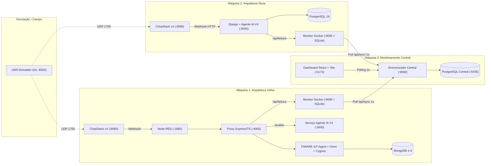

# Relatório de Auditoria Técnica do Sistema

Auditoria completa das três frentes do projeto (**Arquitetura Nova**, **Arquitetura Velha**, **Dashboard Central de Monitoramento / Sincronizador**), além do pipeline científico do **Agente Inteligente V4** e da **higiene do repositório Git**.

---

## 1. Visão Geral da Arquitetura Auditada

---

## 2. Achados Críticos e Altos (Prioridade Imediata)

> [!CAUTION]
> Os itens **C1 a C4** afetam diretamente a **validade científica das métricas coletadas** na dissertação (training-serving skew, janelas temporais truncadas e perda silenciosa de leituras no sincronizador) ou expõem o host via Docker Socket.

### C1. [CRÍTICO] Perda silenciosa de leituras no Sincronizador Central (`LIMIT 100` fixo sem cursor)
- **Onde:** [sincronizador_central.py](file:///c:/Users/erroso/Projeto_Me_Tornei_Um_Mestre/Projeto_Me_Tornei_um_Mestre/Código/Monitoramento/Dashboard_Esperimento/sincronizador_central.py#L184-L204) e [monitorar_recursos_docker.py](file:///c:/Users/erroso/Projeto_Me_Tornei_Um_Mestre/Projeto_Me_Tornei_um_Mestre/Código/Arquitetura_Nova/monitorar_recursos_docker.py#L361-L374)
- **Problema:** Enquanto `recursos_docker` sincroniza incrementalmente usando `after_id` e `after_ts`, a tabela `leituras_processamento` **sempre retorna apenas `ORDER BY id DESC LIMIT 100`** sem filtro incremental, e o `sincronizador_central.py` reenvia e executa `INSERT ... ON CONFLICT DO NOTHING` dessas mesmas 100 linhas a cada **1 segundo**.
  1. Se o sincronizador ficar offline por algum tempo e mais de 100 leituras ocorrerem nas máquinas 1 ou 2, **as leituras anteriores às 100 mais recentes jamais serão sincronizadas** para o PostgreSQL Central.
  2. A constraint `UNIQUE(arquitetura, timestamp_recebimento)` em [sincronizador_central.py](file:///c:/Users/erroso/Projeto_Me_Tornei_Um_Mestre/Projeto_Me_Tornei_um_Mestre/Código/Monitoramento/Dashboard_Esperimento/sincronizador_central.py#L109) descarta leituras legítimas caso dois sensores enviem pacotes no mesmo instante.
- **Como corrigir:** Passar `after_leitura_id` na querystring de `/api/sync`, filtrar `WHERE id > ? ORDER BY id ASC LIMIT ?` também para `leituras_processamento`, e incluir `origem_id` ou `(arquitetura, dev_eui, timestamp_recebimento)` na constraint `UNIQUE`.

---

### C2. [CRÍTICO] *Training-Serving Skew* em 3 pontos da Inferência do Agente V4
- **Onde:**
  1. [treinar_agente_v4.py](file:///c:/Users/erroso/Projeto_Me_Tornei_Um_Mestre/Projeto_Me_Tornei_um_Mestre/Código/Arquitetura_Nova/treinar_agente_v4.py#L109-L113) vs. [services.py](file:///c:/Users/erroso/Projeto_Me_Tornei_Um_Mestre/Projeto_Me_Tornei_um_Mestre/Código/Arquitetura_Nova/agente/services.py#L106-L156) e [servico_agente_velha.py](file:///c:/Users/erroso/Projeto_Me_Tornei_Um_Mestre/Projeto_Me_Tornei_um_Mestre/Código/Arquitetura_Velha/servico_agente_velha.py#L85-L135)
  2. [services.py](file:///c:/Users/erroso/Projeto_Me_Tornei_Um_Mestre/Projeto_Me_Tornei_um_Mestre/Código/Arquitetura_Nova/agente/services.py#L48) vs. [services.py](file:///c:/Users/erroso/Projeto_Me_Tornei_Um_Mestre/Projeto_Me_Tornei_um_Mestre/Código/Arquitetura_Nova/agente/services.py#L62-L97)
  3. [servico_agente_velha.py](file:///c:/Users/erroso/Projeto_Me_Tornei_Um_Mestre/Projeto_Me_Tornei_um_Mestre/Código/Arquitetura_Velha/servico_agente_velha.py#L50)
- **Problema:**
  1. **Ausência de reamostragem de 1 min e mediana móvel causal na inferência:** No treino (`treinar_agente_v4.py`), os dados passam por `resample("1min").mean().interpolate(limit=3)` e filtro `rolling(window=3, center=False).median()`, onde `JANELA = 30` representa **30 minutos**. Na inferência (`services.py` e `servico_agente_velha.py`), o modelo recebe as **32 últimas leituras brutas** sem reamostragem para 1 min e sem mediana móvel causal. Se o sensor transmite a cada 10s ou 30s, a janela de "30 minutos" enxerga apenas 5 a 15 minutos, alterando completamente a escala das derivadas de `DinamicaTemporal` (`t - t-4`, `t - t-1`) e do `delta_std`.
  2. **Divergência no `gap_max_s` e no Hot-Reload:** `services.py` linha 48 usa default `60.0` (`config_agente.json` traz `900.0`), mas `recarregar_modelo()` (linhas 78–86) **esquece de atualizar `self.gap_max_s` e `self.classes`**.
  3. **Truncamento da janela de 8h na Arquitetura Velha:** Em [servico_agente_velha.py](file:///c:/Users/erroso/Projeto_Me_Tornei_Um_Mestre/Projeto_Me_Tornei_um_Mestre/Código/Arquitetura_Velha/servico_agente_velha.py#L50), `deque(maxlen=1000)` guarda apenas ~2,7 horas quando o sensor envia a cada 10s (ou ~5,5h a cada 20s), truncando a média móvel de 8h (`CO_media_8h`), enquanto a Arquitetura Nova consulta 8h reais no PostgreSQL. Isso introduz viés entre as duas arquiteturas.
- **Como corrigir:** Extrair uma função única em `agente/preprocessamento.py` que aplique a mediana móvel causal `rolling(3)` (e opcionalmente reamostragem) antes de montar o tensor `(N_JANELAS_CONFIRMACAO, JANELA, 8)`, aumentar `maxlen=3000` em `servico_agente_velha.py` e atualizar `gap_max_s`/`classes` no `recarregar_modelo()`.

---

### C3. [CRÍTICO] Hot-Reloading do comando `retreinar_agente` não tem efeito no servidor Web em execução
- **Onde:** [retreinar_agente.py](file:///c:/Users/erroso/Projeto_Me_Tornei_Um_Mestre/Projeto_Me_Tornei_um_Mestre/Código/Arquitetura_Nova/agente/management/commands/retreinar_agente.py#L245)
- **Problema:** `python manage.py retreinar_agente` roda em um **processo Python separado** do processo `manage.py runserver` que atende os webhooks. Chamar `AirQualifyService.recarregar_modelo()` dentro do comando `retreinar_agente` verifica `if cls._instance is not None:` (que é sempre `None` no processo CLI!) e retorna `False`, **nunca recarregando o modelo em memória no processo web**.
- **Como corrigir:** Verificar o `st_mtime` de `modelo_iqar.keras` em `AirQualifyService.avaliar_janela()` (custo de microsegundos via `os.stat`) e acionar `cls.recarregar_modelo()` automaticamente quando o arquivo for atualizado no disco, ou expor um endpoint interno de reload no Django.

---

### C4. [CRÍTICO] Viés Metodológico na Comparação Experimental (Arquitetura Nova vs. Velha)
- **Onde:**
  - [Arquitetura_Nova/entrypoint.sh](file:///c:/Users/erroso/Projeto_Me_Tornei_Um_Mestre/Projeto_Me_Tornei_um_Mestre/Código/Arquitetura_Nova/entrypoint.sh#L18-L35)
  - [Arquitetura_Velha/docker-compose.yml](file:///c:/Users/erroso/Projeto_Me_Tornei_Um_Mestre/Projeto_Me_Tornei_um_Mestre/Código/Arquitetura_Velha/docker-compose.yml#L6-L238)
  - [Arquitetura_Velha/monitorar_recursos_docker.py](file:///c:/Users/erroso/Projeto_Me_Tornei_Um_Mestre/Projeto_Me_Tornei_um_Mestre/Código/Arquitetura_Velha/monitorar_recursos_docker.py#L411)
- **Problema:** Uma banca examinadora pode questionar a equidade da comparação experimental por 4 fatores:
  1. **Contêineres extras na Arquitetura Velha:** `PREFIXOS_CONTAINERS = ("velha_", "fiware-", "db-mongo", "grafana")` inclui `grafana` e `fiware-tutorial` (`tutorials.context-provider`), que não participam do fluxo de ingestão/inferência mas somam RAM e CPU em `TOTAL_ARQUITETURA`.
  2. **Nível de log assimétrico:** Na Arquitetura Velha, Orion (`-logLevel DEBUG`), IoT-Agent (`IOTA_LOG_LEVEL=DEBUG`), Cygnus (`CYGNUS_LOG_LEVEL=DEBUG`) e Tutorial (`DEBUG=tutorial:*`) estão em modo DEBUG verboso, inflando I/O e CPU.
  3. **Versões de Postgres diferentes na camada ChirpStack:** A Arquitetura Nova usa `postgres:16-alpine` (compartilhado entre ChirpStack e Django), enquanto a Arquitetura Velha usa `postgres:14-alpine` para o ChirpStack.
  4. **Django com `runserver` e `DEBUG=True`:** Na Arquitetura Nova, mesmo em `--producao`, o `entrypoint.sh` usa `python manage.py runserver --noreload` com `DEBUG=True` (que acumula histórico de queries em memória no Django se não for limpo, ou adiciona overhead de dev). Além disso, `makemigrations` no entrypoint cria migrações automáticas dentro do container a cada boot.
- **Como corrigir:** Remover (ou isolar em profile opcional) `grafana` e `fiware-tutorial` da soma `TOTAL_ARQUITETURA`, mudar logs do FIWARE para `WARN`/`ERROR` ou `INFO`, padronizar `postgres:16-alpine` no ChirpStack da Velha e usar `gunicorn` (ou `DEBUG=False`) em modo produção na Nova.

---

### A1. [ALTO] Divergência de Classificação do IQAr (CONAMA 491/2018 vs. `calcIQAR.ts` vs. EPA)
- **Onde:** [calcIQAR.ts](file:///c:/Users/erroso/Projeto_Me_Tornei_Um_Mestre/Projeto_Me_Tornei_um_Mestre/Código/Arquitetura_Velha/no-commenter-project/mqda/iot-fiware/tutorials.IoT-Agent/src/helpers/calcIQAR.ts#L22-L76) e [IotControllers.ts](file:///c:/Users/erroso/Projeto_Me_Tornei_Um_Mestre/Projeto_Me_Tornei_um_Mestre/Código/Arquitetura_Velha/no-commenter-project/mqda/iot-fiware/tutorials.IoT-Agent/src/controllers/IotControllers.ts#L181-L186)
- **Problema:**
  1. Em `calcIQAR.ts`, `roundValue()` arredonda o CO para inteiro antes de buscar a faixa (`9.4 ppm` vira `9` -> "Boa"; `9.5 ppm` vira `10` -> "Moderada"). Além disso, a função `roundValue` tem código morto (`if (rounded % 2 !== 0 && rounded !== 500) return Math.round(sensorValue); return rounded;` — ambos os ramos retornam o mesmo valor).
  2. Se `sensorValue < 0`, `calculateIndex` cai no `else` e retorna `400` ("Péssima")! E se nenhum gás válido estiver presente, `Math.max(...[])` retorna `-Infinity`, que `getQualityLabel(-Infinity)` classifica como `"Boa"`.
  3. Em `IotControllers.ts` linha 185: `alertaReativo` na Arquitetura Velha dispara se `iqarReativo === "Ruim" || (iqarLabel && iqarLabel !== "Boa" && iqarLabel !== "Moderada")`, enquanto na Arquitetura Nova ([telemetria/views.py](file:///c:/Users/erroso/Projeto_Me_Tornei_Um_Mestre/Projeto_Me_Tornei_um_Mestre/Código/Arquitetura_Nova/telemetria/views.py#L106)) dispara **apenas** quando `iqar_reativo == "Ruim"` (`co >= 9.5`). Isso pode gerar contagens de `alertas_reativos` diferentes para o mesmo CO nas duas arquiteturas.

---

### A2. [ALTO] Desalinhamento temporal nos gráficos comparativos do Dashboard (`App.tsx`)
- **Onde:** [App.tsx](file:///c:/Users/erroso/Projeto_Me_Tornei_Um_Mestre/Projeto_Me_Tornei_um_Mestre/Código/Monitoramento/Dashboard_Esperimento/src/App.tsx#L322-L338)
- **Problema:** `dadosComparativos` alinha `histVelha` e `histNova` **por índice de array a partir do fim** (`offset = maxPontos - 1 - idx`), e usa `timestamp: n?.timestamp || v?.timestamp`. Se uma das máquinas ficou desligada por 10 minutos ou teve menos amostras, os pontos do gráfico comparativo sobrepõem horários completamente distintos sob o mesmo eixo X!
- **Como corrigir:** Fazer o *join*/alinhamento por bucket de timestamp (ex.: arredondado para 5s no modo `5m` ou pelo próprio `date_bin` retornado pelo PostgreSQL nas janelas maiores).

---

### A3. [ALTO] Vazamento de Dados Sutil no `treinar_agente_v4.py` (Interpolação e Média Móvel antes do Split)
- **Onde:** [treinar_agente_v4.py](file:///c:/Users/erroso/Projeto_Me_Tornei_Um_Mestre/Projeto_Me_Tornei_um_Mestre/Código/Arquitetura_Nova/treinar_agente_v4.py#L109-L159)
- **Problema:** Embora o código tenha excelente cuidado ao ajustar `clip_max` e `MinMaxScaler` apenas em `masc_treino` e verificar `particao[todos_inicios] == particao[alvos_futuros]`, a **média móvel de 8h** (`media_movel_co` nas linhas 149–150) é calculada na série contínua inteira antes do particionamento em blocos semanais (70% treino / 15% val / 15% teste). Assim, as primeiras 8 horas de cada partição de validação e de teste carregam na feature `CO_media_8h` (e no rótulo `rotulos`) leituras das últimas 8 horas da partição anterior.
- **Impacto:** Pequeno, porém fácil de blindar para evitar questionamentos na defesa.

---

### A4. [ALTO] Dependências com versões futuras/inexistentes no PyPI e npm (`requirements.txt` e `package.json`)
- **Onde:** [Arquitetura_Nova/requirements.txt](file:///c:/Users/erroso/Projeto_Me_Tornei_Um_Mestre/Projeto_Me_Tornei_um_Mestre/Código/Arquitetura_Nova/requirements.txt#L1-L56) e [Dashboard_Esperimento/package.json](file:///c:/Users/erroso/Projeto_Me_Tornei_Um_Mestre/Projeto_Me_Tornei_um_Mestre/Código/Monitoramento/Dashboard_Esperimento/package.json#L12-L36)
- **Problema:** Como o relógio do ambiente está em `2026` ou pacotes pré-release foram congelados, há versões como `tensorflow==2.22.0rc0` e no `Dockerfile` do Dashboard é executado `npm install --legacy-peer-deps && npm install --legacy-peer-deps recharts lucide-react` a cada build (mesmo já estando no `package.json`), além de rodar `npm run dev` (servidor Vite de desenvolvimento com HMR e `CHOKIDAR_USEPOLLING=true`, que consome CPU continuamente na máquina 3).

---

## 3. Segurança, Concorrência e Estabilidade (Médio)

| ID | Severidade | Arquivo / Linha | Descrição do Problema | Recomendação |
| :--- | :---: | :--- | :--- | :--- |
| **M1** | **Médio** | [telemetria/views.py](file:///c:/Users/erroso/Projeto_Me_Tornei_Um_Mestre/Projeto_Me_Tornei_um_Mestre/Código/Arquitetura_Nova/telemetria/views.py#L50-L51) | **Criação ilimitada de Threads:** `registrar_metrica_leitura` cria uma nova `threading.Thread` a cada uplink sem fila/pool. Se `monitor-recursos` travar ou sob rajadas de uplinks, centenas de threads acumulam. | Usar uma `queue.Queue(maxsize=1000)` com 1 única thread *worker* daemon consumidora (ou `ThreadPoolExecutor(max_workers=2)`). |
| **M2** | **Médio** | [Cloudant.ts](file:///c:/Users/erroso/Projeto_Me_Tornei_Um_Mestre/Projeto_Me_Tornei_um_Mestre/Código/Arquitetura_Velha/no-commenter-project/mqda/iot-fiware/tutorials.IoT-Agent/src/db/Cloudant.ts#L79-L115) e [L188-L191](file:///c:/Users/erroso/Projeto_Me_Tornei_Um_Mestre/Projeto_Me_Tornei_um_Mestre/Código/Arquitetura_Velha/no-commenter-project/mqda/iot-fiware/tutorials.IoT-Agent/src/db/Cloudant.ts#L188-L191) | **Escrita duplicada e Full Scan no MongoDB:** `createDocumentSensor` grava cada leitura **duas vezes** (`db.collection("sensors").insertOne` E `db.collection("galpaotocorredordois").insertOne`). Além disso, `findLastDocByIdRoom` faz `.find({ roomRef }).toArray()` trazendo **todo o histórico** para a memória do Node.js para achar o documento mais recente. | Remover a segunda inserção redundante (ou documentar se for exigência legada da Arquitetura Velha) e usar `.find({ roomRef }).sort({ _id: -1 }).limit(1)`. |
| **M3** | **Médio** | [telemetria/models.py](file:///c:/Users/erroso/Projeto_Me_Tornei_Um_Mestre/Projeto_Me_Tornei_um_Mestre/Código/Arquitetura_Nova/telemetria/models.py#L15-L59) | **Falta de índices compostos no PostgreSQL (Django):** `AirReading` filtra a cada pacote por `(sensor, -timestamp)` e `(sensor, timestamp__gte, timestamp__lte)`, e `AgentAlert` filtra por `(sensor, tipo, resolvido, timestamp__gte)`. Ao longo de 30 dias de experimento, as queries vão degradar gradualmente a latência da Arquitetura Nova. | Adicionar `indexes = [models.Index(fields=['sensor', '-timestamp'])]` em `AirReading` e `models.Index(fields=['sensor', 'tipo', 'resolvido', '-timestamp'])` em `AgentAlert`. |
| **M4** | **Médio** | [sincronizador_central.py](file:///c:/Users/erroso/Projeto_Me_Tornei_Um_Mestre/Projeto_Me_Tornei_um_Mestre/Código/Monitoramento/Dashboard_Esperimento/sincronizador_central.py#L51-L52) e [L84-L111](file:///c:/Users/erroso/Projeto_Me_Tornei_Um_Mestre/Projeto_Me_Tornei_um_Mestre/Código/Monitoramento/Dashboard_Esperimento/sincronizador_central.py#L84-L111) | **Nova conexão TCP ao Postgres a cada 1s + Cast de `TEXT` para `timestamptz`:** `get_conn()` abre e fecha uma conexão nova a cada 1s no sync e a cada 2s no polling do dashboard (~1,5 conexões/s). Além disso, `timestamp` é armazenado como `TEXT` e convertido em tempo de consulta com `timestamp::timestamptz >= NOW() - INTERVAL ...`, impedindo uso eficiente de índice em 15 dias de coleta (~260 mil linhas por arquitetura). | Usar `ThreadedConnectionPool` do `psycopg2.pool` e criar um índice funcional ou coluna `TIMESTAMPTZ` indexada. |
| **M5** | **Médio** | [settings.py](file:///c:/Users/erroso/Projeto_Me_Tornei_Um_Mestre/Projeto_Me_Tornei_um_Mestre/Código/Arquitetura_Nova/Projeto_Me_Tornei_Um_Mestre/settings.py#L24-L28), [monitorar_recursos_docker.py](file:///c:/Users/erroso/Projeto_Me_Tornei_Um_Mestre/Projeto_Me_Tornei_um_Mestre/Código/Arquitetura_Nova/monitorar_recursos_docker.py#L401-L405) | **Segurança de APIs e Credenciais:** `SECRET_KEY` hardcoded no `settings.py`, `DEBUG = True` fixo (não lê `APP_MODE`), `/api/config-urls` no `sincronizador_central.py` permite SSRF para qualquer URL arbitrária sem autenticação, e os containers `monitor-recursos` montam `/var/run/docker.sock` como `root` expondo portas `9095`/`9096` em `0.0.0.0`. | Ler `SECRET_KEY` e `DEBUG` de variáveis de ambiente (`DEBUG = os.environ.get("APP_MODE") != "producao"`), validar host/porta em `_normalizar_url()` e restringir bind se em rede pública. |

---

## 4. Manutenibilidade, Duplicação e Higiene do Repositório (Baixo / Organização)

### B1. Alta duplicação de código entre `Arquitetura_Nova` e `Arquitetura_Velha`
1. **`monitorar_recursos_docker.py` (683 linhas na Nova vs. 685 linhas na Velha):** São **98% idênticos**, diferindo apenas em `PREFIXOS_CONTAINERS`, `arquitetura` default, porta (`9095` vs `9096`) e no comando de start/stop do container do agente. Qualquer ajuste precisa ser editado em dois lugares.
2. **Motor de inferência duplicado:** `Arquitetura_Nova/agente/services.py` e `Arquitetura_Velha/servico_agente_velha.py` duplicam ~110 linhas da lógica de normalização, cálculo de erro do autoencoder, detecção de sensor travado, previsão do delta e geração de mensagem de alerta.
3. **Scripts de experimentos duplicados:**
   - `Experimentos/experimento_comum.py` e `Experimentos/experimentos/experimento_comum.py` (idênticos, 10.644 bytes)
   - `Experimentos/experimento_normalizacao.py` e `Experimentos/experimentos/experimento_normalizacao.py` (idênticos, 29.519 bytes)

### B2. `App.tsx` monolítico (1.003 linhas) e URL de API fixa
- **Onde:** [App.tsx](file:///c:/Users/erroso/Projeto_Me_Tornei_Um_Mestre/Projeto_Me_Tornei_um_Mestre/Código/Monitoramento/Dashboard_Esperimento/src/App.tsx#L8)
- **Problema:** `const API_BASE = "http://localhost:9090"` está hardcoded. Se o dashboard for aberto de outro computador na rede local pelo IP da 3ª máquina (ex.: `http://192.168.0.20:5173`), o navegador tentará acessar `localhost:9090` da máquina cliente e falhará.
- **Como corrigir:** Usar `const API_BASE = import.meta.env.VITE_API_BASE || \`http://\${window.location.hostname}:9090\``.

### B3. Higiene do Git e Artefatos Versionados Indevidamente
A inspeção do repositório Git revelou:
- **Repositório com ~345 MiB** (`.git` pack de 286 MiB + 59 MiB loose objects).
- **Arquivos binários/compilados e temporários rastreados pelo Git (`git ls-files`):**
  - Bancos SQLite ativos e de backup: `Código/Arquitetura_Nova/monitoramento/metricas_experimento.db` (1,95 MB) e `backup_metricas_experimento.db` (3,30 MB) — geram conflitos e diffs binários a cada commit!
  - Bytecode Python rastreado: `Código/Arquitetura_Velha/__pycache__/*.pyc` e `Código/Monitoramento/Dashboard_Esperimento/__pycache__/*.pyc`.
  - Artefatos de compilação LaTeX rastreados: `Escrita/**/*.aux`, `Escrita/Revisao_Bibliografica.log`, `Escrita/texput.log`.
  - 4 arquivos JSON de ~3,5 MB cada em `Código/Arquitetura_Velha/.../json/json-camp3/*.json` (~14 MB).
  - Typo no nome do arquivo `Escrita/READEME.md`.
- **Mensagens de commit recentes desconexas do conteúdo:** Commits como `7bbd48d` (*"fix: handle null pointer exception in user authentication service"*) e `66d9313` (*"refactor: remove empty file list from commit context"*) alteraram na verdade o Dashboard React e o `monitorar_recursos_docker.py` (provavelmente gerados por ferramenta automática de mensagem de commit mal calibrada).

---

## 5. Pontos Fortes Identificados no Sistema

> [!TIP]
> O projeto apresenta decisões de engenharia e metodologia científica muito bem construídas que merecem destaque na dissertação:
> 1. **Grafo compilado com `@tf.function` + Warm-up** em `AirQualifyService`: reduz a latência de inferência da Bi-LSTM de ~5.650 ms (Eager) para ~31 ms.
> 2. **Camada customizada `DinamicaTemporal` serializável** (`@tf.keras.utils.register_keras_serializable`), eliminando problemas de desserialização de camadas `Lambda`.
> 3. **Gatekeeper de Qualidade no Retreino (`retreinar_agente.py`)**: faz backup automático do `.keras` e `.json` antes do retreino e promove o modelo novo apenas se atingir a acurácia mínima configurada no Django Admin.
> 4. **Desacoplamento da coleta de recursos via Docker Socket** em container dedicado (`monitor-recursos`), sem contaminar a soma `TOTAL_ARQUITETURA`.
> 5. **Provisionamento zero-touch** tanto no ChirpStack + PostgreSQL da Arquitetura Nova (`garantir_chirpstack.py`) quanto no ChirpStack + MongoDB + FIWARE Orion/IoT-Agent/Cygnus da Arquitetura Velha (`provisionar_arquitetura_velha.js`).

---

## 6. Plano de Ação Recomendado (Ordem de Execução)

1. **Corrigir o pipeline de dados do experimento (Críticos C1, C2, C3):**
   - Adicionar paginação incremental (`after_leitura_id`) para `leituras_processamento` entre `monitorar_recursos_docker.py` e `sincronizador_central.py`.
   - Unificar o pré-processamento da janela na inferência (`services.py` e `servico_agente_velha.py`) com mediana móvel causal e aumentar o buffer de 8h (`maxlen=3000`) na Arquitetura Velha.
   - Implementar recarregamento automático por `mtime` do arquivo `modelo_iqar.keras` em `AirQualifyService` para que o `retreinar_agente` funcione entre processos.
2. **Blindar a validade científica da comparação entre arquiteturas (C4 e A1):**
   - Retirar `grafana` e `fiware-tutorial` da soma de recursos da Arquitetura Velha (ou desativá-los durante a bateria experimental) e reduzir o log level do FIWARE de `DEBUG` para `INFO`/`WARN`.
   - Padronizar a regra de `alerta_reativo_presente` nas duas arquiteturas e corrigir os casos de borda em `calcIQAR.ts`.
3. **Corrigir o Dashboard e o Sincronizador (A2, M4, B2):**
   - Alinhar os gráficos comparativos por timestamp em vez de índice de array em `App.tsx`.
   - Trocar `API_BASE` em `App.tsx` para usar `window.location.hostname`.
4. **Limpar o Repositório Git (B1, B3):**
   - Adicionar `*.db`, `*.db-wal`, `*.db-shm`, `__pycache__/`, `*.pyc`, `*.aux`, `*.log`, `*.bcf`, `*.run.xml` ao `.gitignore` raiz e remover do índice (`git rm --cached`) sem apagar os arquivos locais.
   - Remover a duplicata dos scripts em `Experimentos/experimentos/`.

